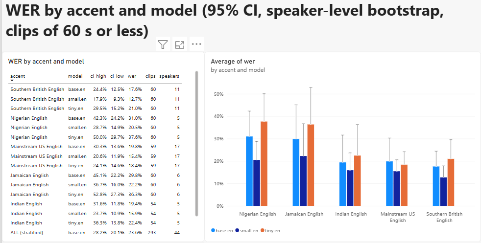
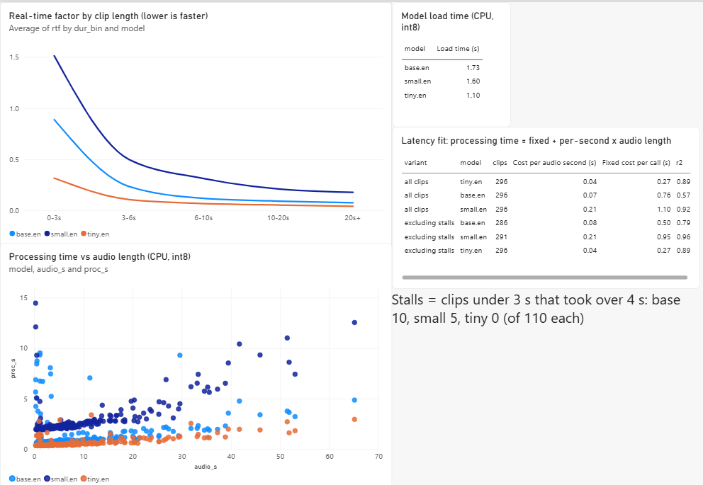
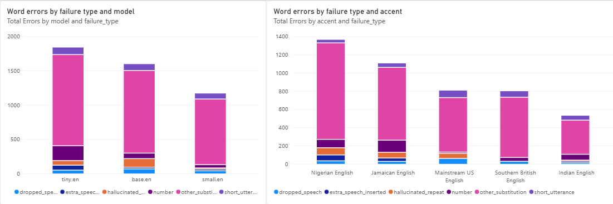

# STT Benchmark Dashboard

Which open speech-to-text model works best for which accents, and what slows a voice pipeline down.

Status: benchmark, failure analysis, Power BI dashboard and PostHog pipeline instrumentation done.

## Setup
- Data: EdAcc (Edinburgh International Accents of English Corpus), validation + test splits, accent labels assigned by linguists. License: CC-BY-SA per the Edinburgh DataShare record.
- Sample: 296 clips collected (5 accents, 44 speakers, about 49 minutes of audio), up to 60 per accent spread across speakers. Clips under 3 words or with tag markers removed. Accuracy is scored on the 293 clips of 60 s or less; latency uses all 296.
- Models: Whisper tiny.en, base.en, small.en via faster-whisper. CPU, int8, 4 threads, beam size 5, VAD off, forced English.
- Machine: Intel Core i5-10300H, 16 GB RAM, Windows. Warm-up run excluded.
- Scoring: Whisper English text normalizer on both reference and output. WER pooled per accent. 95% CIs from a speaker-level bootstrap (2000 resamples). Latency as real-time factor (processing time / audio duration).

## Results
Scored on 293 clips of 60 s or less (see Limitations). WER pooled per accent, 95% CI from a speaker-level bootstrap.

Overall WER (stratified bootstrap) and pooled real-time factor:
- tiny.en: 27.2% (23.6-31.8), RTF 0.08
- base.en: 23.6% (20.1-28.2), RTF 0.17
- small.en: 17.3% (14.9-20.3), RTF 0.34

WER by accent (tiny / base / small):
- Indian English (5 speakers): 22.4% / 19.4% / 15.9%
- Jamaican English (6): 36.3% / 29.8% / 22.2%
- Mainstream US English (17): 18.4% / 19.8% / 15.4%
- Nigerian English (5): 37.6% / 31.0% / 20.5%
- Southern British English (11): 21.0% / 17.6% / 12.7%

Findings:
1. small.en beats tiny.en on every accent, and the bootstrap interval on the difference excludes zero for all 5.
2. The gain from a bigger model is largest where WER is highest: Nigerian English (-17.1 points) and Jamaican English (-14.1 points), against -3.0 for US English.
3. Latency roughly doubles with each size step. small.en costs about 4.5x the compute of tiny.en.
4. Short clips cost more per second of audio (see Latency breakdown).
5. Among clips with errors, 74-78% are tagged as ordinary mishearings. Clips with a digit mismatch are few (18 tiny, 10 base, 9 small, of 293) and hallucinated repeats are rarer (2-6 per model). Each clip gets one tag from the first rule it matches, so a tag describes the clip, not every word error in it. The tagger is rule-based and was not validated by hand.

## Limitations
- Small sample: 5-17 speakers per accent, so the intervals are wide. Accent rankings are NOT supported: the intervals overlap heavily.
- Two long Indian English clips (about 357 s and 200 s) held 62% of that accent's reference words and one long US English clip held 159. They are excluded from accuracy scoring. With them included, small.en Indian English WER would be 10.3% instead of 15.9%, which would make it look like the best accent. WER on very short clips is also noisy.
- EdAcc is conversational speech, so references contain partial words and disfluencies, and some clips have speech the reference does not cover.
- Latency is from one run on one laptop CPU, not repeated trials.
- Each failing clip gets one failure tag (first matching rule).

## Reproduce
python data/make_manifest.py
python benchmark/run.py cpu
python analysis/wer.py
python analysis/tag_failures.py

## Layout
- data/ manifest and dataset prep
- benchmark/ transcription runner and raw outputs
- analysis/ WER, RTF, bootstrap, failure tagging
- dashboard/ Power BI file, dashboard data and screenshots
- agent/ voice pipeline demo that sends events to PostHog

## Latency breakdown
CPU, int8, 4 threads, one run per clip.

Fit per model: processing time = fixed cost per call + cost per second of audio.
- tiny.en: 0.27 s + 0.043 s per audio second (r2 0.89)
- base.en: 0.50 s + 0.075 s per audio second (r2 0.79, excluding stalls; 0.76 s and r2 0.57 with them)
- small.en: 0.95 s + 0.211 s per audio second (r2 0.96, excluding stalls; 1.10 s with them)

Short clips (under 3 s, 110 per model): median processing time is 0.38 s for tiny, 0.68 s for base and 2.03 s for small. Without stalls, small.en still runs at RTF 1.27 on these clips (slower than real time), against 0.32 for tiny.

Stalls: 15 of 330 short-clip runs (base 10, small 5, tiny 0) took over 4 s, up to 14 s, for clips under 3 s long. In a re-test of 5 slow small.en clips, default decoding took 8-11 s and temperature=0 took about 2 s, which points at decoder retries. This is a small test, default timings varied between runs, and the effect of temperature=0 on WER was not checked.

Takeaway: model size sets the per-second cost, and per-call overhead dominates short utterances, which is the typical size of a voice-agent turn. Why the fixed cost exists (for example Whisper's 30-second input window) was not tested.

Model load time with cached models: about 1.1 s (tiny), 1.7 s (base), 1.6 s (small). First-run loads were much slower, likely model downloads, and are not reported.

## Data quality notes
- 15 clips per model have an implausible speech rate (over 6 words per second), likely bad segment boundaries in EdAcc. Dropping them changes WER by about a point or less and does not change the model ordering (tiny.en 27.2% to 26.6%, base.en 23.6% to 23.0%, small.en 17.3% to 16.6%).

## Voice pipeline latency (PostHog)
agent/demo.py runs 30 scripted sessions: a benchmark clip (12 s or less) is the user turn, then Whisper (tiny.en or small.en, assigned at random: 16 and 14 sessions), an LLM (Groq, openai/gpt-oss-20b, low reasoning effort), and text-to-speech (edge-tts, whole file synthesized and saved). Each stage sends a latency_ms event to PostHog, with conversation_started and conversation_completed around them. These are test sessions, not production traffic.

Median stage latency:
- tiny.en sessions (16): STT 0.62 s, LLM 0.51 s, TTS 1.26 s, about 2.4 s end to end (sum of the three stages)
- small.en sessions (14): STT 2.77 s, LLM 0.59 s, TTS 1.20 s, about 4.6 s end to end (sum of the three stages)

Takeaway: with tiny.en the largest stage is TTS; with small.en it is STT. Stages run one after another with no streaming, and TTS is the time to synthesize and save the whole file over the network, so these are not time-to-first-audio figures. 30 of 30 sessions completed according to the local log (dashboard/data/agent_events.csv). The slowest STT call took 4.1 s (tiny.en; cause not investigated). The small.en group has 14 sessions, so treat the gap between the two models as indicative.

Events carry a run property, and run4 is the run reported here. Earlier failed runs (an invalid key, a retired model and a duplicated run) are also in the PostHog project. No PostHog insights or dashboards were built; the figures above are computed from the local log.

## Dashboard
Power BI file: dashboard/stt_benchmark.pbix (open in Power BI Desktop).

Accuracy (WER by accent and model, 95% CI, clips of 60 s or less):

Latency (real-time factor by clip length, processing time vs audio length). The scatter hides two clips over 70 s (about 200 s and 357 s), which follow the same linear trend:

Failure types (word errors by model and by accent, clips of 60 s or less):

